# PricklyGuy xLights Models

A visual catalog of the xmodel files in models/. Filenames are preserved. The embedded xLights name is listed beside each file. The name check ignores an optional leading PGC filename prefix and extra spaces after underscores.

Previews show the model node layout when the `.xmodel` contains a custom node map. Other previews identify the model type where no node map is embedded.

| Preview | File in repo | Model name in file | Name check | Preview detail |
|---|---|---|---|---|
|  | [3-Arch.xmodel](models/3-Arch.xmodel) | 3-Arch | matches | 150 plotted nodes · 99 × 58 |
| 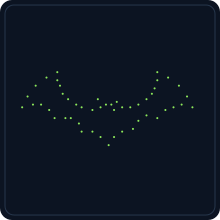 | [50_ node_bat.xmodel](models/50_%20node_bat.xmodel) | 50_node_bat | matches | 50 plotted nodes · 74 × 35 |
|  | [Bulb Singer 1.xmodel](models/Bulb%20Singer%201.xmodel) | Bulb Singer 1 | matches | 170 plotted nodes · 190 × 379 |
|  | [Bulb Singer 2 Female.xmodel](models/Bulb%20Singer%202%20Female.xmodel) | Bulb Singer 2 Female | matches | 170 plotted nodes · 189 × 398 |
|  | [Bulb Singer 3.xmodel](models/Bulb%20Singer%203.xmodel) | Bulb Singer 3 | matches | 170 plotted nodes · 190 × 379 |
| 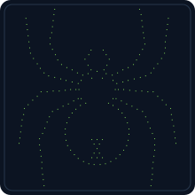 | [Large Spider_200.xmodel](models/Large%20Spider_200.xmodel) | Large Spider_200 | matches | 200 plotted nodes · 208 × 234 |
| 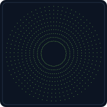 | [PCG-Wreath.xmodel](models/PCG-Wreath.xmodel) | PCG-Wreath | matches | 650 plotted nodes · 300 × 300 |
|  | [PGC Bat_48.xmodel](models/PGC%20Bat_48.xmodel) | PGC Bat_48 | matches | 100 plotted nodes · 76 × 48 |
| 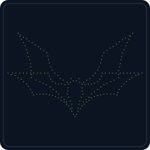 | [PGC Flying Bat lrg.xmodel](models/PGC%20Flying%20Bat%20lrg.xmodel) | PGC Flying Bat lrg | matches | 200 plotted nodes · 175 × 110 |
| 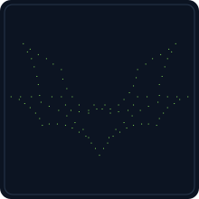 | [PGC Flying Bat sm.xmodel](models/PGC%20Flying%20Bat%20sm.xmodel) | PGC Flying Bat sm | matches | 100 plotted nodes · 133 × 85 |
| 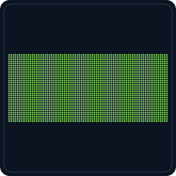 | [PGC Upper Matrix L.xmodel](models/PGC%20Upper%20Matrix%20L.xmodel) | Upper Matrix L | matches | 2400 plotted nodes · 75 × 32 |
|  | [PGC Upper Matrix R.xmodel](models/PGC%20Upper%20Matrix%20R.xmodel) | Upper Matrix R | matches | 2400 plotted nodes · 75 × 32 |
|  | [PGC_Door_Spider.xmodel](models/PGC_Door_Spider.xmodel) | PGC_Door_Spider | matches | 200 plotted nodes · 220 × 234 |
|  | [PGC-Tombstone.xmodel](models/PGC-Tombstone.xmodel) | PGC-Tombstone | matches | 150 plotted nodes · 278 × 368 |
| 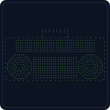 | [Radio_EFL.xmodel](models/Radio_EFL.xmodel) | Radio_EFL | matches | 700 plotted nodes · 190 × 97 |
|  | [Singing Bulb Blue.xmodel](models/Singing%20Bulb%20Blue.xmodel) | Singing Bulb Blue | matches | 170 plotted nodes · 190 × 379 |
|  | [Singing Bulb Green.xmodel](models/Singing%20Bulb%20Green.xmodel) | Singing Bulb Green | matches | 170 plotted nodes · 306 × 660 |
|  | [Singing Bulb Purple.xmodel](models/Singing%20Bulb%20Purple.xmodel) | Singing Bulb Purple | matches | 170 plotted nodes · 190 × 379 |
| 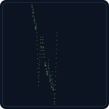 | [Singing Bulb Red.xmodel](models/Singing%20Bulb%20Red.xmodel) | Singing Bulb Red | matches | 170 plotted nodes · 306 × 660 |
|  | [Singing Tree Barry.xmodel](models/Singing%20Tree%20Barry.xmodel) | Singing Tree Barry | matches | 191 plotted nodes · 200 × 200 |
| 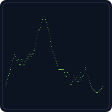 | [Singing Tree Chip.xmodel](models/Singing%20Tree%20Chip.xmodel) | Singing Tree Chip | matches | 191 plotted nodes · 200 × 200 |
| 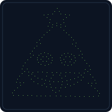 | [Singing Tree Doug.xmodel](models/Singing%20Tree%20Doug.xmodel) | Singing Tree Doug | matches | 195 plotted nodes · 200 × 200 |
| 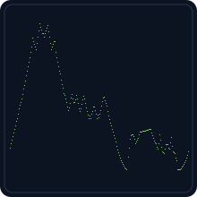 | [Singing Tree Holly.xmodel](models/Singing%20Tree%20Holly.xmodel) | Singing Tree Holly | matches | 199 plotted nodes · 200 × 200 |
| 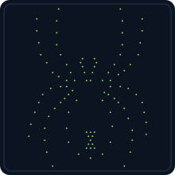 | [Spider sm.xmodel](models/Spider%20sm.xmodel) | Spider sm | matches | 100 plotted nodes · 60 × 80 |
|  | [Updated_Rustic_Cross.xmodel](models/Updated_Rustic_Cross.xmodel) | Updated_Rustic_Cross | matches | 403 plotted nodes · 161 × 247 |

The original `.xmodel` files are in [`models/`](models/). Preview SVGs and the generator are in [`previews/`](previews/).
