# PricklyGuy xLights Models

A visual catalog of the xmodel files in models/. Filenames are preserved as supplied. The Model name in file column shows the name stored inside each xLights file; the name check flags any difference from the filename.

Previews show the model node layout when the `.xmodel` contains a custom node map. Other previews identify the model type where no node map is embedded.

| Preview | File in repo | Model name in file | Name check | Preview detail |
|---|---|---|---|---|
| 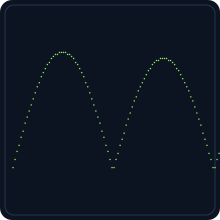 | [3-Arch.xmodel](models/3-Arch.xmodel) | Arch 1 | ⚠ differs | 150 plotted nodes · 99 × 58 |
| 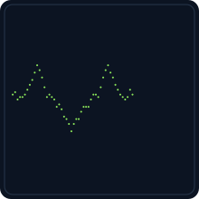 | [5_ node_bat.xmodel](models/5_%20node_bat.xmodel) | Bat 8 | ⚠ differs | 50 plotted nodes · 74 × 35 |
| 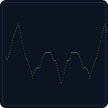 | [Bat PGC Flying lrg.xmodel](models/Bat%20PGC%20Flying%20lrg.xmodel) | Bat PGC Flying - 1 | ⚠ differs | 200 plotted nodes · 175 × 110 |
| 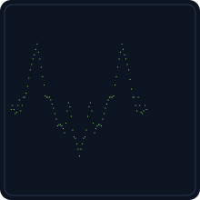 | [Bat PGC Flying sm.xmodel](models/Bat%20PGC%20Flying%20sm.xmodel) | Bat PGC Flying -9 | ⚠ differs | 100 plotted nodes · 133 × 85 |
| 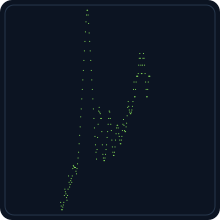 | [Bulb Singer 1.xmodel](models/Bulb%20Singer%201.xmodel) | Singer 1 | ⚠ differs | 170 plotted nodes · 190 × 379 |
| 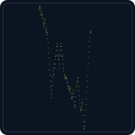 | [Bulb Singer 2 Female.xmodel](models/Bulb%20Singer%202%20Female.xmodel) | Singer 2 Female | ⚠ differs | 170 plotted nodes · 189 × 398 |
|  | [Bulb Singer 3.xmodel](models/Bulb%20Singer%203.xmodel) | Singer 3 | ⚠ differs | 170 plotted nodes · 190 × 379 |
|  | [Large Spider_200.xmodel](models/Large%20Spider_200.xmodel) | Large Spider_200 | matches | 200 plotted nodes · 208 × 234 |
|  | [PCG-Wreath.xmodel](models/PCG-Wreath.xmodel) | MOAW_PCGW R | ⚠ differs | 650 plotted nodes · 300 × 300 |
| 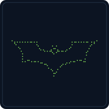 | [PGC Bat_48.xmodel](models/PGC%20Bat_48.xmodel) | Batman_48 | ⚠ differs | 100 plotted nodes · 76 × 48 |
|  | [PGC Upper Matrix L.xmodel](models/PGC%20Upper%20Matrix%20L.xmodel) | Upper Matrix L | ⚠ differs | preview map unavailable |
|  | [PGC Upper Matrix R.xmodel](models/PGC%20Upper%20Matrix%20R.xmodel) | Upper Matrix R | ⚠ differs | preview map unavailable |
| 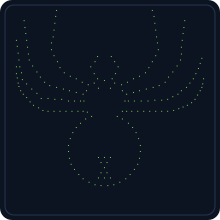 | [PGC_Door_Spider.xmodel](models/PGC_Door_Spider.xmodel) | Door Prop | ⚠ differs | 200 plotted nodes · 220 × 234 |
| 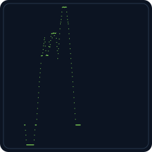 | [PGC-Tombstone.xmodel](models/PGC-Tombstone.xmodel) | Tombstone 1 | ⚠ differs | 150 plotted nodes · 278 × 368 |
|  | [Radio_EFL.xmodel](models/Radio_EFL.xmodel) | Radio_EFL | matches | 700 plotted nodes · 190 × 97 |
|  | [Singing Bulb Blue.xmodel](models/Singing%20Bulb%20Blue.xmodel) | Singing Bulb Blue | matches | 170 plotted nodes · 190 × 379 |
|  | [Singing Bulb Green.xmodel](models/Singing%20Bulb%20Green.xmodel) | Singing Bulb Green | matches | 170 plotted nodes · 306 × 660 |
|  | [Singing Bulb Purple.xmodel](models/Singing%20Bulb%20Purple.xmodel) | Singing Bulb Purple | matches | 170 plotted nodes · 190 × 379 |
|  | [Singing Bulb Red.xmodel](models/Singing%20Bulb%20Red.xmodel) | Singing Bulb Red | matches | 170 plotted nodes · 306 × 660 |
| 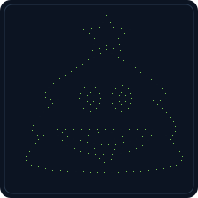 | [Singing Tree Barry.xmodel](models/Singing%20Tree%20Barry.xmodel) | Singing Tree 1 Barry | ⚠ differs | 191 plotted nodes · 200 × 200 |
|  | [Singing Tree Chip.xmodel](models/Singing%20Tree%20Chip.xmodel) | Singing Tree 4 Chip | ⚠ differs | 191 plotted nodes · 200 × 200 |
|  | [Singing Tree Doug.xmodel](models/Singing%20Tree%20Doug.xmodel) | Singing Tree 3 Doug | ⚠ differs | 195 plotted nodes · 200 × 200 |
|  | [Singing Tree Holly.xmodel](models/Singing%20Tree%20Holly.xmodel) | Singing Tree 2 Holly | ⚠ differs | 199 plotted nodes · 200 × 200 |
|  | [Spider sm.xmodel](models/Spider%20sm.xmodel) | Spider 9 | ⚠ differs | 100 plotted nodes · 60 × 80 |
| 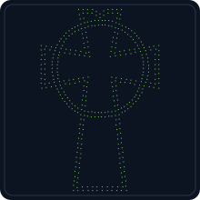 | [Updated_Rustic_Cross.xmodel](models/Updated_Rustic_Cross.xmodel) | Cross - Old Rustic 2 | ⚠ differs | 403 plotted nodes · 161 × 247 |

The original `.xmodel` files are in [`models/`](models/). Preview SVGs and the generator are in [`previews/`](previews/).
